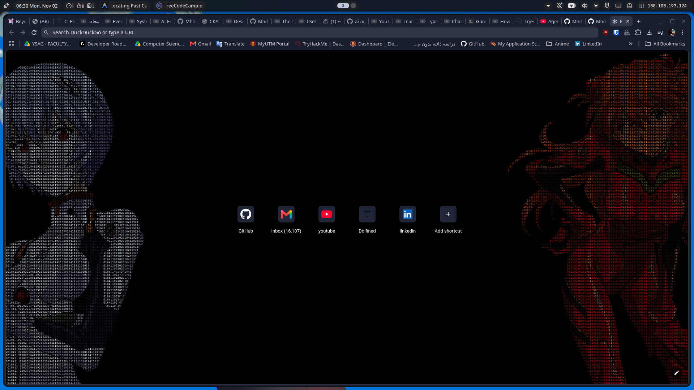
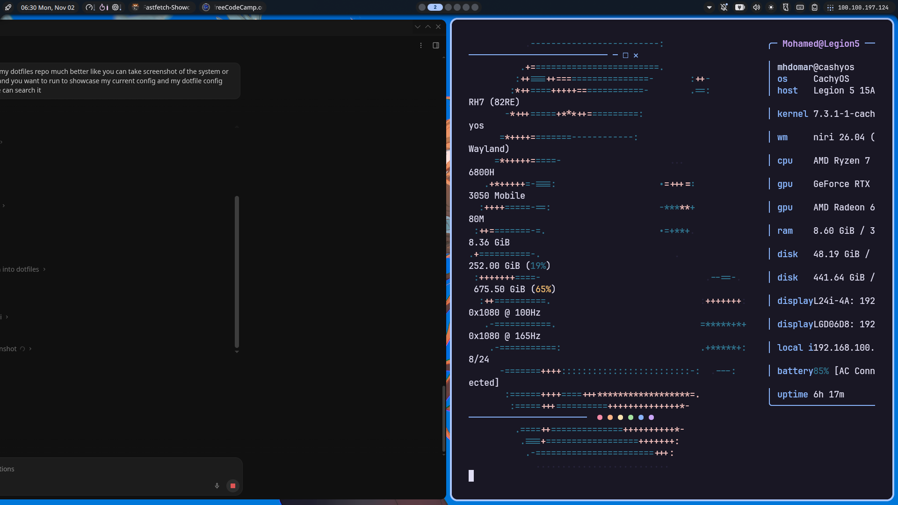

<div align="center">

# Niri Dotfiles (CachyOS + Noctalia Shell)

**Scrollable Wayland desktop configuration on CachyOS Linux with Niri, Noctalia Shell, Kitty, Fish, and Catppuccin Mocha.**

[](https://cachyos.org)
[](https://github.com/YaLTeR/niri)
[](https://fishshell.com)
[](https://sw.kovidgoyal.net/kitty/)
[](https://noctalia.dev)
[](https://github.com/catppuccin/catppuccin)
[](LICENSE)

<br/>



<br/><br/>



</div>

---

## Features and Workflow

- **Scrollable Tiling:** Niri arranges windows into dynamic columns along an infinite horizontal ribbon, avoiding the cramped splits of traditional grid tilers.
- **Screen Share Privacy Shield:** The `block-out-from "screencast"` rule turns password managers (Bitwarden, KeePassXC) and messaging apps into black boxes during Discord, Google Meet, or Zoom shares while keeping them fully legible on your local display.
- **Screencast Target Indicator:** Any window actively captured by an active video stream or recording tool displays a distinct red outline via `is-window-cast-target`.
- **Desktop Song Recognition:** Pressing `Mod + Shift + M` samples your PipeWire speaker sink using SongRec (Shazam CLI), copies the track name to the clipboard, and triggers a desktop notification.
- **Region Screen OCR:** Pressing `Mod + Shift + O` lets you drag a crop area via `slurp` and extracts text directly into the Wayland clipboard using Tesseract (configured for Arabic and English).
- **Media Controls:** Dedicated shortcuts for Spotify playback (`Mod + M` toggle, `Mod + .` next, `Mod + ,` previous) and background Holy Quran Radio streaming (`Mod + C`).
- **Kitty Scrollback Search:** Pressing `Ctrl + Shift + F` inside Kitty overlays an interactive fuzzy search (`fzf`) over the full terminal history and output buffer.
- **DevSecOps Shell Utilities:** Custom Fish functions for system health, including cache cleaning (`clean`), process hunting (`slay`), zombie process tracking (`zombies`), and config integrity diffs (`pkgdiff`).
- **Night Light:** Toggles `wlsunset` color temperature to 4000K with `Mod + N`.

---

## Hardware

Tested and daily-driven on:

| Component | Specification |
| :--- | :--- |
| **Model** | Lenovo Legion 5 15ARH7 (82RE) |
| **Processor** | AMD Ryzen 7 6800H (16 threads, up to 4.7 GHz) |
| **Integrated GPU** | AMD Radeon 680M |
| **Dedicated GPU** | NVIDIA GeForce RTX 3050 Mobile |
| **Memory** | 38 GB DDR5 |
| **Storage** | 2 TB PCIe Gen 4 NVMe SSD |
| **Built-in Screen** | 1920x1080 @ 165.00 Hz (eDP-2) |
| **External Monitor** | Lenovo L24i-4A 1920x1080 @ 100 Hz (DP-3) |

---

## Software Stack

| Component | Software | Config Location |
| :--- | :--- | :--- |
| **Compositor** | [Niri](https://github.com/YaLTeR/niri) | `niri/config.kdl`, `niri/cfg/*.kdl` |
| **Desktop Shell** | [Noctalia Shell](https://noctalia.dev) | `niri/noctalia.kdl` |
| **Terminal** | [Kitty](https://sw.kovidgoyal.net/kitty/) | `kitty/kitty.conf` |
| **Shell** | [Fish](https://fishshell.com) | `fish/config.fish`, `fish/functions/` |
| **Prompt** | [Starship](https://starship.rs) | `~/.config/starship.toml` |
| **File Manager** | [Yazi](https://github.com/sxyazi/yazi) + [Dolphin](https://apps.kde.org/dolphin/) | `~/.config/yazi/` |
| **Multiplexer** | [Zellij](https://zellij.dev) | `zellij/config.kdl` |
| **Video Player** | [MPV](https://mpv.io) (uosc overlay) | `mpv/mpv.conf` |
| **Git & Containers** | [Lazygit](https://github.com/jesseduffield/lazygit) / [Lazydocker](https://github.com/jesseduffield/lazydocker) | `lazygit/config.yml` |
| **System Info** | [Fastfetch](https://github.com/fastfetch-cli/fastfetch) | `fastfetch/config.jsonc` |

---

## Repository Structure

```text
.
├── assets/          # Screenshots for preview and documentation
├── bin/             # Standalone helper scripts (OCR, Shazam, Wi-Fi monitor)
├── fastfetch/       # System information fetch layout
├── fish/            # Shell functions, aliases, and environment hooks
├── kitty/           # Terminal configuration and keybindings
├── lazygit/         # Git TUI styling
├── mpv/             # Media player configuration with uosc interface
├── niri/            # Compositor layout, keybindings, and window rules
├── packages/        # Local package patches (e.g. Noctalia Qt 6.12 compatibility)
└── zellij/          # Terminal multiplexer layouts and options
```

---

## Keybindings

`Mod` refers to the **Super (Windows) key**.

### Applications and Quick Actions

| Keybinding | Action | Details |
| :--- | :--- | :--- |
| `Mod + Return` | Kitty Terminal | Opens terminal with Starship prompt |
| `Mod + R` | Application Launcher | Noctalia app search and launcher |
| `Mod + E` | File Manager | Opens Dolphin |
| `Mod + Shift + E` | Emoji Picker | Noctalia emoji selection palette |
| `Mod + B` | Web Browser | Launches Helium (or Firefox fallback) |
| `Mod + O` | Obsidian | Launches personal notes vault |
| `Mod + Shift + O` | Screen OCR | Crops screen region and copies text to clipboard |
| `Mod + M` | Spotify Play/Pause | Toggles playback with track notification toast |
| `Mod + .` *(or `>`)* | Spotify Next | Skips track with desktop notification |
| `Mod + ,` *(or `<`)* | Spotify Previous | Previous track with desktop notification |
| `Mod + Shift + M` | Shazam SongRec | Identifies audio playing through speakers |
| `Mod + H` | Discord | Launches Vesktop client |
| `Mod + V` | Clipboard History | Opens CopyQ clipboard manager |
| `Mod + W` | Wallpaper Selector | Noctalia wallpaper picker |
| `Mod + Shift + W` | Window Switcher | Noctalia window search and focus |
| `Mod + S` | Control Center | Opens Noctalia quick settings |
| `Mod + N` | Night Light Toggle | Toggles wlsunset 4000K warm color temperature |
| `Mod + C` | Quran Radio | Toggles background Quran radio stream |
| `Mod + L` | Screen Lock | Locks session via Noctalia lockscreen |
| `Mod + Shift + Q` | Session Menu | Power off, reboot, and logout menu |

### Window Management and Navigation

| Keybinding | Action | Details |
| :--- | :--- | :--- |
| `Mod + Left / Right` | Focus Column | Moves focus to adjacent column |
| `Mod + Up / Down` | Focus Window | Moves focus vertically within column or tab |
| `Mod + Ctrl + Left / Right` | Move Column | Moves column left or right along ribbon |
| `Mod + Shift + T` | Tabbed Column | Toggles column between vertical split and tabs |
| `Mod + [` / `Mod + ]` | Consume Window | Pulls adjacent window into current tabbed group |
| `Mod + D` | Preset Width | Cycles column width between 33%, 50%, and 67% |
| `Mod + F` | Maximize Column | Expands column to fill screen width |
| `Mod + Shift + C` | Center Column | Centers focused column on screen |
| `Mod + T` | Float Window | Toggles floating mode for current window |
| `Mod + Tab` | Workspace Overview | Zoomed out view of all columns and workspaces |
| `Mod + 1 .. 9` | Switch Workspace | Jumps directly to workspace 1 through 9 |
| `Mod + Shift + 1 .. 9` | Move to Workspace | Moves focused column to workspace 1 through 9 |
| `Print` | Quick Screenshot | Captures active monitor to clipboard |
| `Mod + Shift + S` | Interactive Screenshot | Opens Satty annotation tool |

### Terminal Shortcuts (Kitty)

| Keybinding | Action |
| :--- | :--- |
| `Ctrl + Shift + F` | Fuzzy search terminal output with fzf |
| `Ctrl + Enter` | Split pane horizontally |
| `Ctrl + Shift + Enter` | Split pane vertically |
| `Ctrl + Arrow Keys` | Move focus between split panes |
| `Ctrl + T` / `Ctrl + W` | Create new tab / Close active tab |

---

## Custom Shell Functions

These utilities are tracked under `fish/functions/` and available across all shell sessions:

| Command | Description |
| :--- | :--- |
| `wifi-networks` | Scans local Wi-Fi networks and prints a table grouped by frequency (2.4, 5, 6 GHz). |
| `clean` | Cleans pacman cache, paru cache, pip, cargo, docker, and displays free disk space via `duf`. |
| `pkgdiff <file>` | Compares a modified system file against the clean upstream package version. |
| `slay` | Detects and prompts to kill processes consuming more than 90% CPU. |
| `zombies` | Finds zombie processes and prints their parent PID for cleanup. |
| `fast <command>` | Runs command under maximum CPU performance governor profile. |
| `dotenv [file]` | Exports variables from a `.env` file into current session. |
| `hl <pattern>` | Highlights matched text in color while keeping full output visible. |
| `kssh <host>` | Connects via SSH and clones Kitty terminfo to prevent broken remote terminal visuals. |
| `y` | Launches Yazi file manager and changes shell directory to current path on exit. |
| `lg` | Launches Lazygit. |
| `lzd` | Launches Lazydocker. |

---

## Installation and Setup

### 1. Prerequisites

Ensure essential packages are installed on Arch Linux or CachyOS:

```bash
sudo pacman -S --needed \
    niri xwayland-satellite kitty fish starship \
    stow fzf duf yazi zellij lazygit \
    grim slurp wl-clipboard tesseract tesseract-data-eng tesseract-data-ara \
    songrec wlsunset satty
```

### 2. Clone the Repository

```bash
git clone https://github.com/Mhdomer/niri-dotfiles.git ~/dotfiles
```

### 3. Link Configurations with GNU Stow

From the repository directory, run `stow` targeting your home directory:

```bash
stow -v -t ~ fish kitty niri fastfetch lazygit mpv zellij
```

### 4. Link Shell Scripts

Link helper scripts to `~/.local/bin`:

```bash
mkdir -p ~/.local/bin
ln -sf ~/dotfiles/bin/* ~/.local/bin/
```

---

## Credits and License

- **License:** MIT License.
- **Foundations:** Initial inspiration and structure from [robaa12/niri-dotfiles](https://github.com/robaa12/niri-dotfiles).
- **Maintained by:** [Mohamed Makhlouf (Mhdomer)](https://github.com/Mhdomer).
